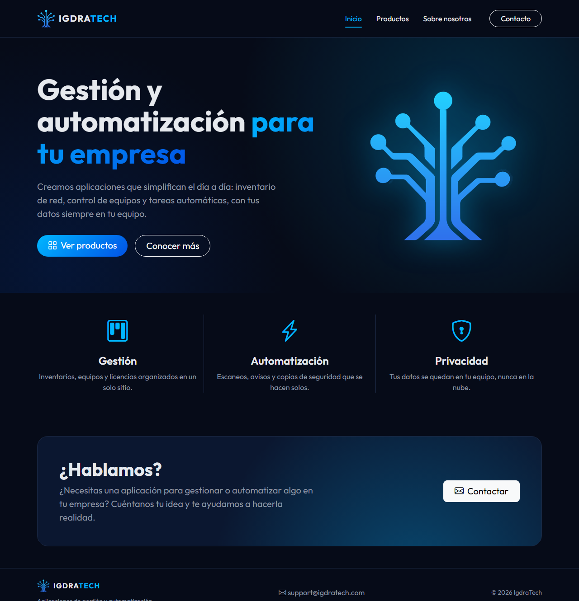
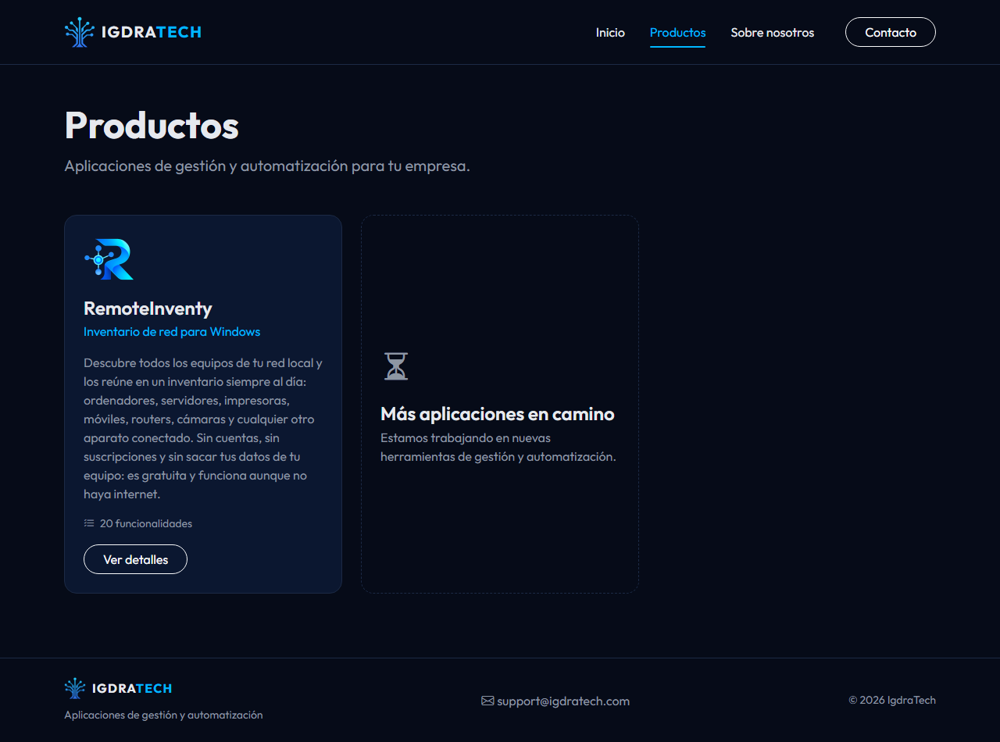
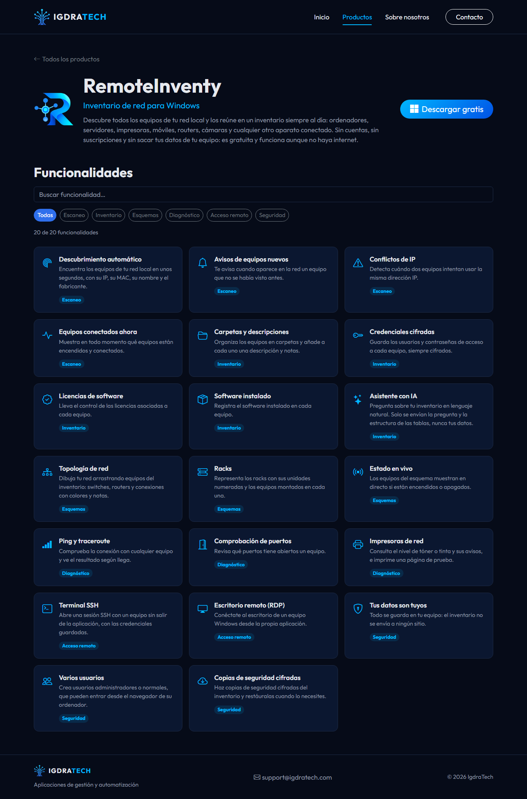
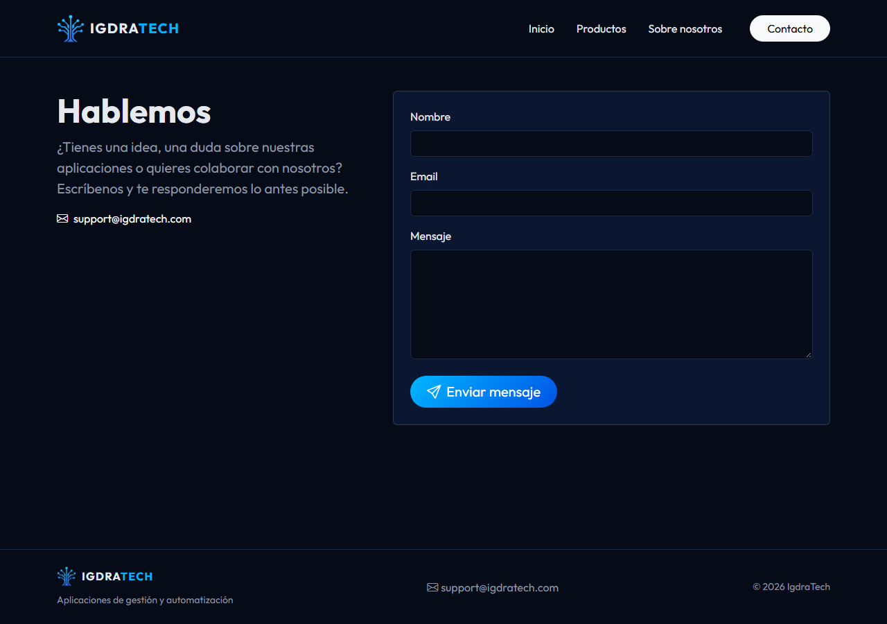
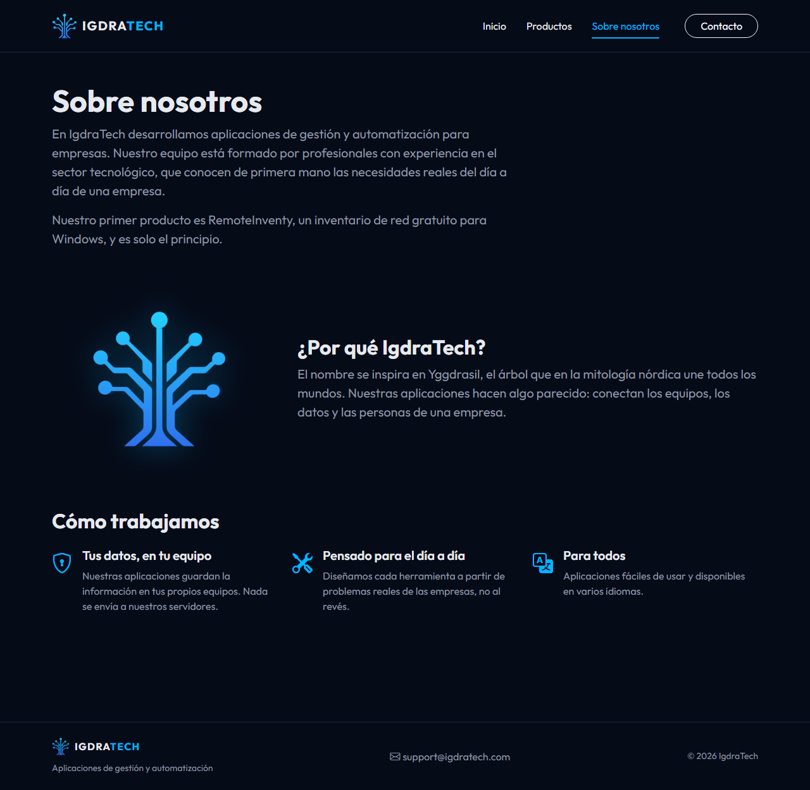
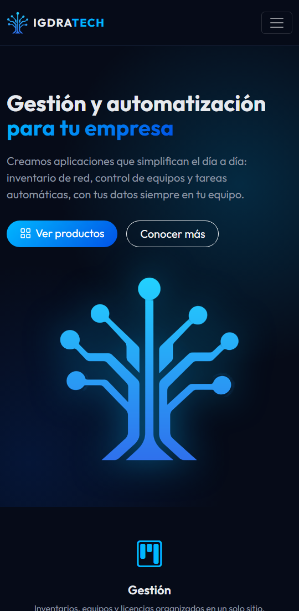
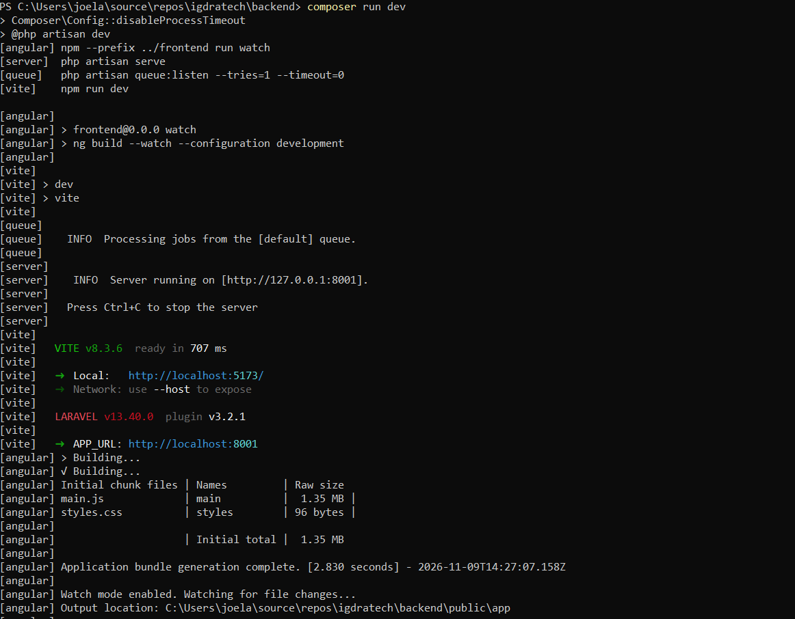

# IgdraTech - web corporativa

Web corporativa de IgdraTech, una empresa ficticia, hecha con Laravel 13, Angular 22 y Bootstrap 5.3
para la prueba técnica de SoftNeos. Todo funciona en local. La aplicación que se presenta,
RemoteInventy (un inventario de red para Windows), sí existe y está publicada en la Microsoft Store.

Todo el proyecto está en castellano para que quede en un solo idioma: los textos de la web, la
documentación y los mensajes de commit. Los nombres en el código (clases, variables, tablas) van en
inglés, que es la convención de Laravel y Angular.



## Qué hay en la web

- **Inicio, Sobre nosotros y Contacto** están hechas con vistas **Blade** de Laravel.
- **Contacto** tiene un formulario que **guarda los mensajes en la base de datos** (SQLite), con
  validación en el servidor y mensajes de error en castellano.
- **Productos** está hecha con **Angular**: un listado y una página de detalle con buscador y filtro
  por categorías. Los datos salen de la base de datos a través de una **API JSON** de Laravel
  (`/api/products` y `/api/products/{slug}`).
- Angular se compila dentro de `backend/public/app` y se carga en una vista Blade con el mismo
  layout, así que todo funciona desde una sola dirección.
- Los colores de la marca están en `shared/scss/_brand.scss`, un archivo que usan tanto Laravel
  como Angular. Bootstrap está compilado desde SCSS con esos colores.

## Capturas

| Productos (Angular) | Detalle con buscador y filtro (Angular) |
|---|---|
|  |  |

| Contacto (Blade + base de datos) | Sobre nosotros (Blade) | Móvil |
|---|---|---|
|  |  |  |

## Requisitos

- PHP 8.3 o superior con la extensión `pdo_sqlite` (probado con PHP 8.5)
- Composer 2
- Node.js 22, 24 o 26 y npm
- Git

Al final se explica cómo instalarlos en Windows.

## Instalación

```bash
git clone https://github.com/Joardoo/igdratech.git
cd igdratech/backend
composer run setup
composer run dev
```

Y abrir http://localhost:8000.

`composer run setup` hace toda la instalación de una vez:

1. instala las dependencias de PHP (`composer install`);
2. crea el `.env` a partir de `.env.example` y genera la clave de la aplicación;
3. crea la base de datos SQLite (`database/database.sqlite`), sus tablas y los datos iniciales
   (`php artisan migrate --seed`);
4. instala y compila el CSS y el JS de Laravel (`npm install` y `npm run build`);
5. instala y compila Angular (`npm install` y `npm run build` en `frontend/`).

La primera vez tarda unos minutos, sobre todo `composer install` en Windows.

`composer run dev` arranca el servidor de PHP, Vite (que recompila el CSS al guardar) y Angular en
modo vigilancia (que lo recompila al guardar).

Si el puerto 8000 está ocupado, se puede cambiar en el `.env` con `SERVER_PORT` y `APP_URL`.

## Tests

```bash
cd backend
php artisan test     # formulario de contacto y API de productos

cd ../frontend
npx ng test          # servicio de Angular que llama a la API
```

## Estructura del repositorio

```
igdratech/
├── backend/    Laravel: páginas Blade, formulario, API, base de datos y tests
├── frontend/   Angular: sección de productos (se compila en backend/public/app)
├── shared/     SCSS con los colores de la marca, común a Laravel y Angular
└── docs/       capturas y declaración del uso de la IA
```

## Cómo se creó el proyecto

### Instalar PHP, Composer y Angular CLI

En Windows, PHP y Composer se pueden instalar con [php.new](https://php.new), que es lo que indica la
[documentación de Laravel](https://laravel.com/docs/installation#installing-php). En PowerShell:

```powershell
Set-ExecutionPolicy Bypass -Scope Process -Force; [System.Net.ServicePointManager]::SecurityProtocol = [System.Net.ServicePointManager]::SecurityProtocol -bor 3072; iex ((New-Object System.Net.WebClient).DownloadString('https://php.new/install/windows/8.5'))
```


Después hay que reiniciar la terminal y comprobar que funciona:

```powershell
php -v
composer -V
```


Para crear la parte de Angular hace falta Angular CLI:

```powershell
npm install -g @angular/cli@22
ng version
```


### Proyecto de Laravel

El proyecto de Laravel está en la carpeta `backend/`. Se creó con el instalador de Laravel, sin
starter kit y con Blade como frontend:

```powershell
laravel new backend
```


El instalador también configura [Laravel Boost](https://laravel.com/docs/boost) para Claude Code
(ver [docs/uso-ia.md](docs/uso-ia.md)).


### Proyecto de Angular

El proyecto de Angular está en la carpeta `frontend/`. Se creó con Angular CLI desde la raíz del
repositorio:

```powershell
ng new frontend --style=scss --routing --ssr=false --zoneless --skip-git --package-manager=npm --ai-config=claude-code
```

- `--style=scss`: estilos en SCSS, como en Laravel, para compartir los colores de la marca.
- `--routing`: incluye el router de Angular.
- `--ssr=false`: sin renderizado en el servidor; las páginas las sirve Laravel.
- `--zoneless`: el modo actual de Angular para detectar cambios, basado en signals.
- `--skip-git`: para no crear un segundo repositorio dentro de `frontend/`.
- `--ai-config=claude-code`: genera `frontend/CLAUDE.md` con buenas prácticas de Angular para
  Claude Code (ver [docs/uso-ia.md](docs/uso-ia.md)).


Angular se compila dentro de `backend/public/app` y la página `/productos` de Laravel lo carga. Su
modo de vigilancia (`ng build --watch`) está registrado en `composer run dev`, así que un solo
comando arranca el servidor, Vite y Angular:



## Uso de la IA

Está explicado en [docs/uso-ia.md](docs/uso-ia.md).
