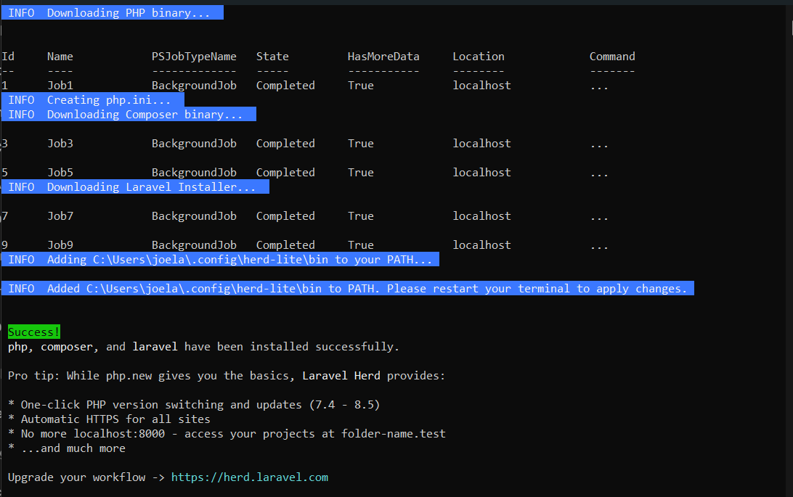
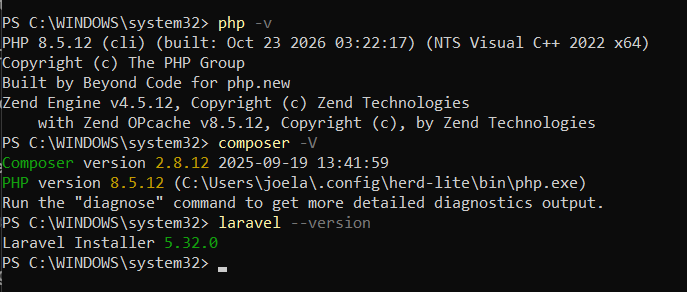
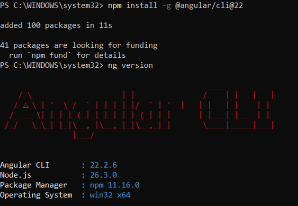
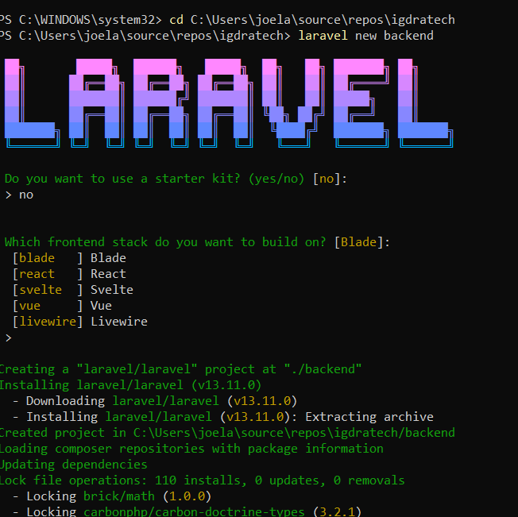
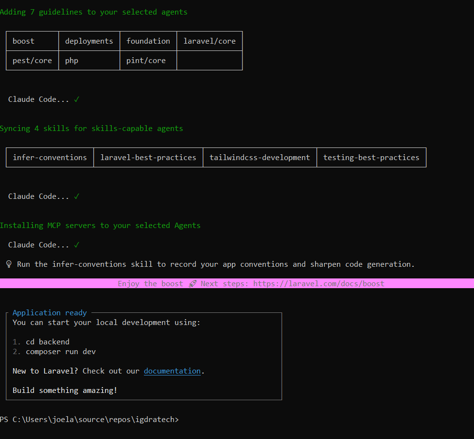
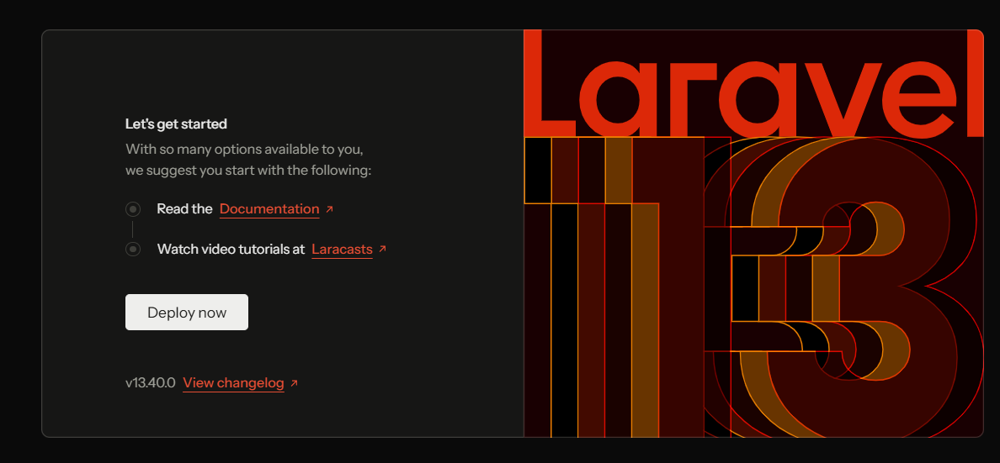
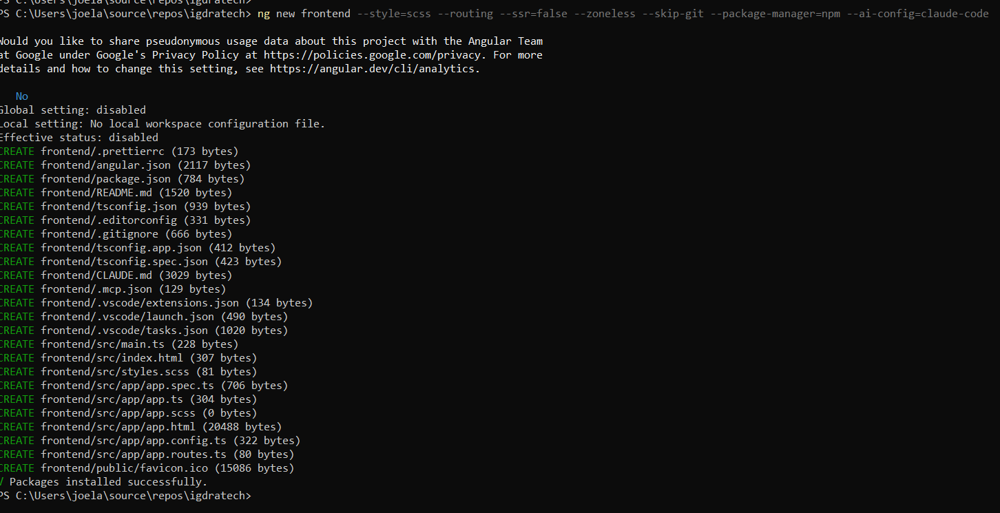

# IgdraTech - web corporativa

Web corporativa de IgdraTech hecha con Laravel 13, Angular 22 y Bootstrap 5.3 para la prueba
técnica de SoftNeos. Todo funciona en local.

He decidido hacer todo en castellano desde el principio para que quede en un solo idioma: los
textos de la web, la documentación y los mensajes de commit. Los nombres en el código (clases,
variables, tablas) van en inglés, que es la convención de Laravel y Angular.

## Requisitos

- PHP 8.3 o superior con la extensión `pdo_sqlite` (he usado PHP 8.5)
- Composer 2
- Node.js 22, 24 o 26 y npm
- Git

En Windows he instalado PHP y Composer con [php.new](https://php.new), que es lo que indica la
[documentación de Laravel](https://laravel.com/docs/installation#installing-php). En PowerShell:

```powershell
Set-ExecutionPolicy Bypass -Scope Process -Force; [System.Net.ServicePointManager]::SecurityProtocol = [System.Net.ServicePointManager]::SecurityProtocol -bor 3072; iex ((New-Object System.Net.WebClient).DownloadString('https://php.new/install/windows/8.5'))
```



Después hay que reiniciar la terminal y comprobar que funciona:

```powershell
php -v
composer -V
```



Para desarrollar la parte de Angular también he instalado Angular CLI:

```powershell
npm install -g @angular/cli@22
ng version
```



## Creación del proyecto

El proyecto de Laravel está en la carpeta `backend/`. Lo creé con el instalador de Laravel,
sin starter kit y con Blade como frontend:

```powershell
laravel new backend
```



El instalador también configura [Laravel Boost](https://laravel.com/docs/boost) para Claude Code
(lo explico en [docs/uso-ia.md](docs/uso-ia.md)).



Para arrancarlo en desarrollo:

```powershell
cd backend
composer run dev
```

Este comando levanta a la vez el servidor de PHP, la cola de trabajos y Vite (que recompila el CSS
y el JS al guardar). Como en mi equipo el puerto 8000 ya estaba ocupado, en el `.env` puse
`SERVER_PORT=8001` y `APP_URL=http://localhost:8001`.



El proyecto de Angular está en la carpeta `frontend/`. Lo creé con Angular CLI desde la raíz del
repositorio:

```powershell
ng new frontend --style=scss --routing --ssr=false --zoneless --skip-git --package-manager=npm --ai-config=claude-code
```

- `--style=scss`: estilos en SCSS, como en Laravel, para compartir los colores de la marca.
- `--routing`: incluye el router de Angular.
- `--ssr=false`: sin renderizado en el servidor; las páginas las sirve Laravel.
- `--zoneless`: el modo actual de Angular para detectar cambios, basado en signals.
- `--skip-git`: para no crear un segundo repositorio dentro de `frontend/`.
- `--ai-config=claude-code`: genera `frontend/CLAUDE.md` con buenas prácticas de Angular para
  Claude Code (ver [docs/uso-ia.md](docs/uso-ia.md)).



## Uso de la IA

Está explicado en [docs/uso-ia.md](docs/uso-ia.md).
